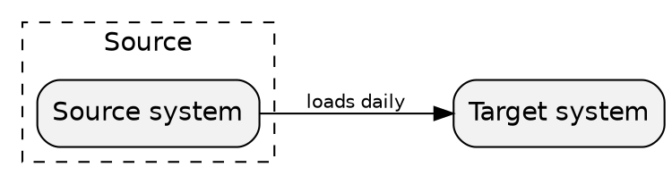

# Graphviz diagrams

Deliver every diagram as a **`.dot` source and a `.png`**, side by side, with the same base name. No SVG or PDF unless the user asks.

## Rules

1. **Every `.dot` file is fully commented.** No exceptions. See "Commenting standard".
2. Write the `.dot` first, render it, look at the PNG, fix, and only then report done.
3. Keep both files next to the document they illustrate (or where the user says). Don't leave them in `$TMPDIR`.
4. If a `.dot` already exists, edit it and re-render. Keep its existing comments true: update them when the code changes.
5. Never invent nodes, systems, owners or numbers. Draw only what the user or the sources give. Ask if unclear.
6. Simple first: fewest nodes and edges that tell the story. Split into two diagrams rather than cram one.
7. Text in diagrams follows the user's wording. Put warnings/status in the label text, not in colour alone (colour-blind safe, prints in grey).

## Commenting standard

Use `//` for line comments and `/* ... */` for the header block. Comment all of these:

- **Header block** at the top: title, what the diagram shows, source of the facts, author/date (absolute date), how to render (`dot -Tpng -Gdpi=200 name.dot -o name.png`).
- **Graph-level settings**: why each of `rankdir`, `splines`, `nodesep`, `ranksep`, `newrank`, `compound` and the like is set.
- **Default styles** (`node [...]`, `edge [...]`): what they are for.
- **Every cluster/subgraph**: what group it represents and why those nodes belong together.
- **Every node**: one comment line above it saying what it is. Group nodes under section comments.
- **Every edge or edge group**: one comment saying what flows or depends on what, and the direction meaning.
- **Colours and styles with meaning** (dashed = optional, red = blocked): explain in a legend comment, and show a legend in the graph when styles carry meaning.
- **Invisible edges, `rank=same`, `constraint=false`, weights and other layout hacks**: say what layout effect they are for.

Check before finishing: every non-blank, non-brace line of statements has a comment on it or directly above it. A quick check is to read the file top to bottom and confirm no node, edge, cluster or setting is unexplained.

## Template



## Render and check

```bash
dot -Tpng -Gdpi=200 name.dot -o name.png
```

- If `dot` is missing: `brew install graphviz`.
- A non-zero exit or a warning means fix the `.dot` first.
- Open the PNG (Read tool) and check: text readable, no overlapping or crossing mess, legend present if styles carry meaning, nothing cut off.
- Report the paths of both files.

## Going into Google Docs

If the PNG goes into a Google Doc or Markdown that will be uploaded, follow the `gdoc-markdown-compat` skill (base64 reference-style images, full-resolution PNG master kept beside the document).
